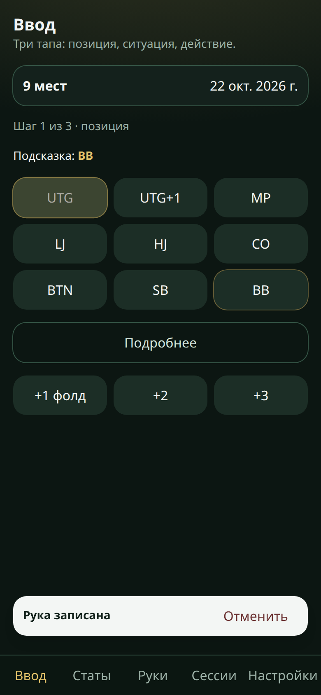
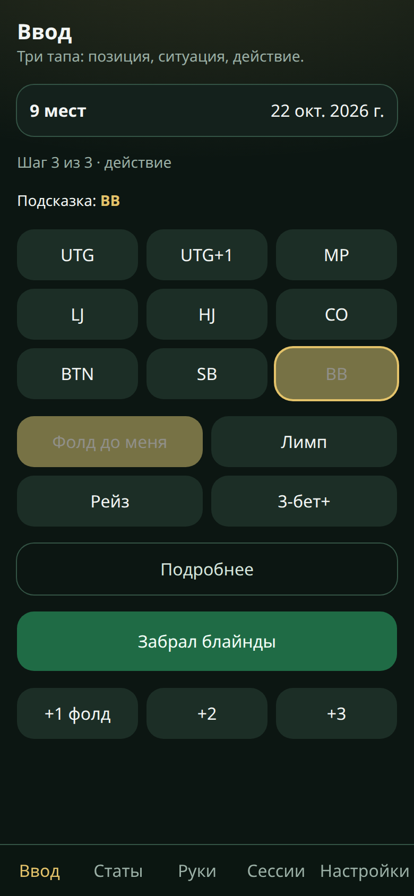
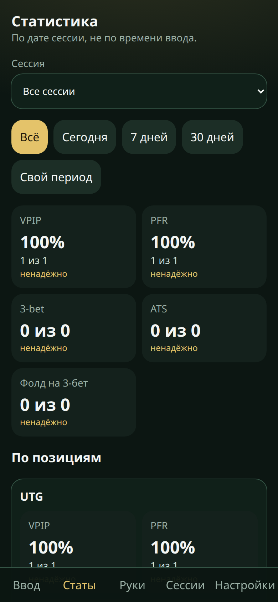

# PokerTracker

Личное приложение, чтобы за столом записывать префлоп и потом смотреть свою статистику. Сервера нет, входить никуда не надо: все руки лежат в этом телефоне.

Первый раз откройте на телефоне https://vasyarns.github.io/PokerTracker/ при включённом интернете. После этого оно открывается и без сети.

## Поставить на экран

Адрес: https://vasyarns.github.io/PokerTracker/. Так телефон реже стирает данные, и запускать удобнее с иконки, а не из вкладки браузера.

**iPhone.** Safari → кнопка «Поделиться» → «На экран Домой». Дальше открывайте PokerTracker с иконки.

**Android.** Chrome → меню → «Установить приложение» или «Добавить на главный экран».

## Как записать руку

Три нажатия, сверху вниз.

1. Позиция.
2. Что было до вас: «Фолд до меня», «Лимп», «Рейз» или «3-бет+».
3. Ваше действие: фолд, колл, рейз или чек. Третье нажатие сразу записывает руку.

Золотая обводка — подсказка, где вы сидите в следующей руке. Её всё равно нужно нажать. После записи подсказка сама сдвигается.

«+1 фолд», «+2» и «+3» записывают одну, две или три руки, где вы просто сбросили и ситуацию не разбирали. Это одно нажатие. «Отменить» под экраном снимает весь этот заход целиком.

«Подробнее» раскрывается на том же экране: результат в больших блайндах, заметка и ответ, если после вашего входа прилетел рейз. Долго жать не нужно.

Сверху строка вроде «9 мест» и дата. Нажмите её, чтобы поменять число игроков и день игры. Руки за вчера пишите во вчерашнюю дату: от времени ввода день не зависит.



## Забрал блайнды

Кнопка есть только на большом блайнде, когда до вас все сбросили. Вы забираете блайнды и ничего не решаете. Это не чек и не фолд: рука записывается, круг позиций сдвигается на одну.

На кнопке написано «Забрал блайнды». Слова «Уок» на экране нет.



## Статистика

Вкладка «Статы». Можно выбрать одну сессию или период. Период смотрит на дату игры, не на то, когда вы успели нажать кнопки.

- **VPIP** — как часто вы сами кладёте фишки в банк до флопа: колл или рейз. Простой сброс сюда не входит. «Забрал блайнды» не считается вообще.
- **PFR** — как часто вы сами рейзите до флопа.
- **3-bet** — как часто вы перерейживаете, если до вас уже был рейз.
- **ATS** — как часто вы рейзите с катоффа, баттона или малого блайнда, когда до вас все сбросили. С других мест вместо ATS стоит прочерк.
- **Фолд на 3-бет** — вы открылись, вам ответили рейзом, и вы сбросили. Это пишется в «Подробнее», пункт «Ответ на рейз».

Рядом с процентом написано «сколько из скольких», например «1 из 1». Если таких возможностей меньше 100, стоит пометка «ненадёжно»: на цифру рано опираться. Если случаев не было, будет «0 из 0». Ниже те же цифры по позициям.



## Сессии и копия на iPhone

На вкладке «Сессии» создают игру, завершают её и открывают снова. Открыта всегда одна: новая закрывает предыдущую.

В кэше итог — сумма больших блайндов, которые вы вписали в руки. В турнире укажите бай-ин и приз: итог равен призу минус бай-ин.

В «Настройках» есть «Экспорт JSON». Сохраните файл, на iPhone лучше в «Файлы». Телефон может стереть данные сайта, чтобы освободить место, особенно если иконки ещё нет на экране «Домой». JSON — ваша копия. «Импорт JSON» вернёт руки, если память очистилась или вы сменили телефон. После каждых пяти завершённых сессий приложение само напишет: «Пора экспортировать JSON». Ввод при этом не блокируется.

## Для разработки

```bash
npm install
npm test
npm run dev
npm run build && npm run preview
```
